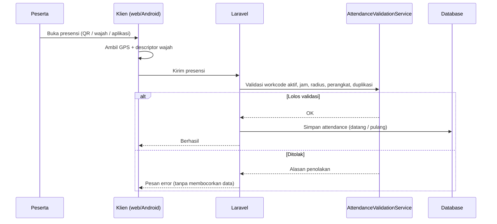
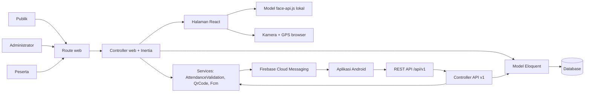
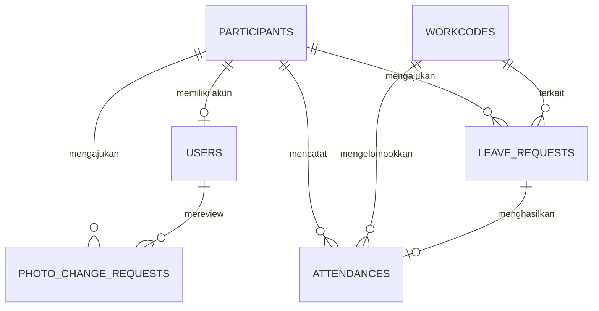

# Presensi SMABA

Sistem presensi digital **SMA Negeri 1 Babat** untuk guru, staf, dan siswa: presensi harian maupun kegiatan sekali jalan, lewat QR, pengenalan wajah, atau aplikasi Android, dengan validasi lokasi (geofence) dan laporan bertanda tangan.


Produksi: <https://smanegeri1babatlmg.sch.id/presensi>

---

## Daftar isi

- [Fitur](#fitur)
- [Cara kerja](#cara-kerja)
- [Arsitektur](#arsitektur)
- [Teknologi](#teknologi)
- [Konsep utama](#konsep-utama)
- [Struktur project](#struktur-project)
- [Instalasi lokal](#instalasi-lokal)
- [Konfigurasi](#konfigurasi)
- [Scheduler dan perintah Artisan](#scheduler-dan-perintah-artisan)
- [API mobile](#api-mobile)
- [Testing](#testing)
- [Deployment](#deployment)
- [Dokumentasi lanjutan](#dokumentasi-lanjutan)
- [Panduan kontribusi singkat](#panduan-kontribusi-singkat)

---

## Fitur

### Administrator (web)
- **Dashboard** ringkasan kehadiran dan sesi aktif.
- **Workcode**: membuat sesi presensi, baik kegiatan satu kali maupun jadwal harian, lengkap dengan jam datang/pulang per hari dan titik lokasi + radius di peta Google Maps.
- **Peserta**: CRUD guru/staf/siswa, impor massal dari Excel/CSV (dengan pratinjau sebelum disimpan), unduh QR pribadi.
- **Scanner QR**: memindai QR pribadi peserta dari kamera perangkat petugas; scan pertama dicatat datang, scan berikutnya pulang.
- **Verifikasi wajah**: menyetujui registrasi wajah dan permintaan ganti foto peserta.
- **Izin**: menyetujui/menolak pengajuan izin (izin penuh, tidak absen datang, tidak absen pulang), termasuk rentang beberapa hari dan dokumen bukti.
- **Master QR**: QR yang ditampilkan di lokasi untuk presensi mandiri; token bisa dirotasi.
- **Laporan**: rekap per peserta dan per tanggal, koreksi manual, ekspor, dan QR tanda tangan kepala sekolah yang bisa diverifikasi publik.

### Peserta (web)
- Dashboard pribadi dan riwayat kehadiran.
- Registrasi wajah mandiri (menunggu persetujuan admin).
- Pengajuan dan riwayat izin.

### Publik
- Halaman depan dengan statistik kehadiran langsung (nama disamarkan).
- **Self check-in** via Master QR: peserta memilih namanya, lalu presensi dengan GPS dan wajah.
- Halaman verifikasi keaslian laporan bertanda tangan.

### Aplikasi Android (via API)
- Login, lihat workcode aktif, presensi dengan **GPS + wajah**, riwayat harian/bulanan, pengajuan izin, ganti foto, dan notifikasi push saat workcode berubah.

---

## Cara kerja

Ada empat jalur presensi, dan semuanya memakai aturan yang sama di `AttendanceValidationService`:

| Jalur | Siapa yang memulai | Identitas dari | Validasi tambahan |
|---|---|---|---|
| Scanner QR | Petugas/admin | QR pribadi peserta | Lokasi (bila scanner mengirim GPS) |
| Self check-in | Peserta, tanpa login | Pilih nama + wajah | GPS, akurasi, radius, perangkat |
| Scanner wajah | Petugas/admin (juga dipakai self check-in) | Wajah (face-api.js, dicocokkan di server) | Hanya wajah berstatus disetujui |
| Aplikasi Android | Peserta, login token | Akun + wajah | GPS, mock location, jam perangkat, perangkat terkunci, idempotency |



Aturan penting:
- **Satu rekaman per peserta, per workcode, per tanggal** (unique constraint di database).
- **Waktu server** adalah sumber kebenaran; jam perangkat Android maksimal selisih 2 menit.
- Jarak dihitung dengan rumus **Haversine** terhadap titik dan radius workcode.
- Setelah sesi berakhir, scheduler menandai peserta yang tidak hadir sebagai **alpha**.

---

## Arsitektur

Monolith Laravel dengan frontend React yang dirender lewat Inertia, ditambah REST API terpisah untuk Android. Web dan API berbagi database dan service yang sama.



---

## Teknologi

| Lapisan | Teknologi |
|---|---|
| Backend | PHP 8.2+, Laravel 12, Laravel Sanctum (token API), Ziggy |
| Frontend | React 18, Inertia 2, Tailwind CSS 3, Headless UI, Vite 7 |
| Presensi | `face-api.js` (model di [public/models/](public/models/)), `html5-qrcode`, Google Maps JavaScript API |
| Lainnya | `simple-qrcode` (pembuatan QR), PhpSpreadsheet (impor/ekspor Excel), `kreait/laravel-firebase` (FCM) |
| Testing | PHPUnit 11, feature test Laravel |
| Database | SQLite (default lokal), MySQL/MariaDB (produksi) |

---

## Konsep utama

| Istilah | Arti |
|---|---|
| **Participant** | Guru, staf, atau siswa yang dipresensi. Bisa terhubung ke akun `User` dengan role `participant`. |
| **Workcode** | Sesi presensi. Kategori `workcode` = kegiatan satu kali dengan jendela aktif tanggal/jam otomatis. Kategori `harian` = jadwal berulang dengan jam datang/pulang per hari. Keduanya bisa memakai geofence. Hanya satu workcode yang aktif dalam satu waktu. |
| **Attendance** | Rekaman kehadiran: `waktu_hadir`, `waktu_pulang`, dan status `hadir`, `izin`, `sakit`, `lupa_absen`, `libur`, atau `alpha`. |
| **Leave request (izin)** | Diajukan peserta, disetujui/ditolak admin. Izin yang disetujui membuat atau memperbarui attendance terkait. |
| **Photo change request** | Permintaan ganti foto wajah. Foto aktif tidak berubah sampai admin menyetujui. |
| **Idempotency key** | UUID v4 di header request tulis API agar pengiriman ulang tidak menggandakan data. |

Relasi data:



---

## Struktur project

```
app/
  Console/Commands/          Perintah terjadwal & pemeliharaan
  Http/Controllers/          Controller web (Inertia)
  Http/Controllers/Api/V1/   Controller API Android
  Http/Resources/Api/V1/     Format JSON API
  Models/                    Participant, Workcode, Attendance, LeaveRequest, ...
  Services/                  AttendanceValidationService, FcmService, QrCodeService
database/migrations/         Skema database
resources/js/Pages/          Halaman React (Admin, Participants, Workcodes, Scanner, Report, ...)
resources/js/Components/     Komponen UI, modal wajah/QR/izin
routes/web.php               Route admin, peserta, dan publik
routes/api.php               Endpoint /api/v1
routes/console.php           Jadwal scheduler
public/models/               Bobot model face-api.js
public/build/                Aset hasil build (di-commit; server tidak butuh Node.js)
deploy/                      Skrip deploy dan setup server
docs/                        Dokumentasi teknis (lihat docs/README.md)
tests/                       Feature & unit test (web dan API)
```

---

## Instalasi lokal

**Kebutuhan:** PHP 8.2+ (dengan extension `mbstring`, `pdo_sqlite`/`pdo_mysql`, `xml`, `curl`, `zip`, `gd`, `fileinfo`), Composer, Node.js 20+, dan database (SQLite sudah cukup; MySQL lewat Laragon juga bisa).

```bash
composer setup        # install dependency, buat .env, generate key, migrate, build aset
php artisan db:seed   # akun admin, contoh peserta
php artisan db:seed --class=SettingSeeder   # nama & NIP kepala sekolah untuk laporan
php artisan storage:link
composer dev          # server + queue + log (Pail) + Vite sekaligus
```

<details>
<summary>Langkah manual tanpa <code>composer setup</code></summary>

```bash
composer install
cp .env.example .env
php artisan key:generate
php artisan migrate
npm install
npm run build
```
</details>

Akun admin awal dibuat oleh [DatabaseSeeder](database/seeders/DatabaseSeeder.php). Password bawaannya **hanya untuk lokal**; segera ganti di instance yang bisa diakses orang lain.

Registrasi publik ditutup, dan akun baru otomatis ber-role `participant`. Admin tambahan dibuat lewat terminal server (password diminta secara interaktif):

```bash
php artisan user:make-admin operator1 --name="Operator TU"
```

> **Kamera** (scanner QR dan wajah) hanya berjalan di *secure context*, yaitu `localhost` atau HTTPS. Untuk uji coba di HP, jalankan lewat HTTPS (SSL Laragon atau tunnel).

---

## Konfigurasi

Variabel penting di `.env`:

| Variabel | Keterangan |
|---|---|
| `APP_URL`, `APP_ENV`, `APP_DEBUG` | Produksi wajib `APP_ENV=production`, `APP_DEBUG=false`, dan HTTPS |
| `DB_*` | Koneksi database |
| `GOOGLE_MAPS_API_KEY` | Key dengan **Maps JavaScript API** aktif, dibatasi ke HTTP referrer web (key khusus Android tidak bisa dipakai browser). Dibaca saat runtime, jadi tidak perlu build ulang; jalankan `php artisan config:clear` bila config di-cache. |
| `FIREBASE_CREDENTIALS` | Path file service account Firebase. Default `storage/app/firebase-credentials.json` (diabaikan Git, **jangan di-commit**). |
| `SANCTUM_*` | Pengaturan token API |

---

## Scheduler dan perintah Artisan

| Perintah | Jadwal | Fungsi |
|---|---|---|
| `attendance:calculate-alpha` | tiap 5 menit | Menandai peserta alpha setelah jendela sesi ditutup |
| `workcode:auto-activate` | tiap menit | Mengaktifkan/menonaktifkan workcode kegiatan sesuai jendela tanggal/jam, lalu kirim FCM |
| `user:make-admin {username}` | manual | Membuat akun admin, atau menaikkan akun yang ada menjadi admin |
| `face:update-descriptor --id=` | manual | Menghitung ulang descriptor wajah peserta |
| `fcm:test [--token=]` | manual | Uji kirim push ke topic default atau satu perangkat |

Lokal: `php artisan schedule:work`. Produksi: tambahkan cron

```
* * * * * cd /path/ke/app && php artisan schedule:run >> /dev/null 2>&1
```

---

## API mobile

Semua endpoint ada di bawah `/api/v1` dan memakai header `Authorization: Bearer <token>` dari `POST /api/v1/auth/login`.

| Endpoint | Fungsi |
|---|---|
| `POST /auth/login`, `POST /auth/logout` | Login (username/email) dan cabut token |
| `GET /me`, `GET /me/photo` | Profil dan foto wajah aktif |
| `GET /workcodes/active` | Workcode yang sedang aktif |
| `POST /attendance` | Presensi datang/pulang dengan GPS + wajah |
| `GET /attendance-history`, `GET /attendance-history/daily` | Riwayat paginated dan rekap harian |
| `GET/POST /leave-requests` | Riwayat dan pengajuan izin |
| `POST /me/photo-change-requests` | Ajukan ganti foto |
| `POST /fcm/register`, `DELETE /fcm/unregister` | Daftar/hapus token notifikasi |

Request tulis (presensi, izin, ganti foto) **wajib** menyertakan `Idempotency-Key` berisi UUID v4. Kirim ulang dengan payload sama mengembalikan respons tersimpan; key sama dengan payload berbeda menghasilkan `409`. Rate limit: 60 request/menit umum, 5 request/menit untuk login.

Spesifikasi lengkap: [docs/api/API_CONTRACT.md](docs/api/API_CONTRACT.md).

---

## Testing

```bash
composer test     # atau: php artisan test
```

Sekitar 110 test mencakup autentikasi, workcode, scanner QR, self check-in (GPS palsu, akurasi, jam perangkat, radius, kunci perangkat), izin, perubahan foto, dan seluruh API v1. Test API ada di [tests/Feature/Api/](tests/Feature/Api/), dikelompokkan per fase implementasi. Skrip deploy menjalankan seluruh test dan membatalkan deploy bila ada yang gagal.

---

## Deployment

Produksi berjalan di shared hosting (Hostinger) melalui SSH. Satu perintah `deploy` menjalankan:

1. seluruh test Laravel, lalu `npm run build`;
2. commit perubahan dan push branch `main` ke GitHub;
3. di server: mode maintenance, `git pull`, `composer install --no-dev --no-scripts` + `package:discover`, `migrate --force`, cache config & view;
4. menyalin `public/` ke folder web, mengarahkan `index.php` ke folder aplikasi, lalu mengaktifkan aplikasi kembali dan memeriksa website.

Persiapan sekali saja:

1. Buat `deploy/.env.deploy` (diabaikan Git) berisi `SSH_HOST`, `SSH_PORT`, `SSH_USER`, `REMOTE_DIR`, `REMOTE_PUBLIC_DIR`, `GITHUB_REPO`, dan `PUBLIC_URL`.
2. Jalankan `powershell -NoProfile -ExecutionPolicy Bypass -File .\deploy\install-deploy-command.ps1`, lalu daftarkan public key yang dicetak ke akun hosting.
3. Buka terminal baru dan jalankan `deploy`.

Catatan server:
- PHP CLI Hostinger menonaktifkan `proc_open`, karena itu Composer dijalankan dengan `--no-scripts`.
- `route:cache` sengaja tidak dipakai karena cache route yang dihasilkan di server membuat `GET /` gagal dengan 405.
- Untuk setup server pertama kali, lihat [deploy/server-setup.sh](deploy/server-setup.sh).

---

## Dokumentasi lanjutan

| Dokumen | Isi |
|---|---|
| [docs/architecture/PROJECT_DOCUMENTATION.md](docs/architecture/PROJECT_DOCUMENTATION.md) | Peta arsitektur lengkap, alur bisnis, model data, route, dan daftar risiko |
| [docs/api/API_CONTRACT.md](docs/api/API_CONTRACT.md) | Kontrak API untuk aplikasi Android |
| [docs/implementation/](docs/implementation/README.md) | Rencana perbaikan Fase 0–6 |
| [docs/README.md](docs/README.md) | Indeks semua dokumen |

---

## Panduan kontribusi singkat

- Kerjakan aturan presensi di `AttendanceValidationService`, bukan di controller, agar web dan Android tetap konsisten. Tambahkan test untuk keduanya.
- Jangan pernah mencatat ke log atau mengembalikan di respons: descriptor wajah, password, token, dokumen izin, atau jarak/koordinat presisi.
- Jangan commit `.env`, `deploy/.env.deploy`, kredensial Firebase, atau password apa pun.
- Untuk migration yang mengubah data: audit data lama, backup database produksi, isi kolom nullable dulu, baru tambahkan constraint.
- Broadcast FCM bersifat *best effort* dan tidak boleh menggagalkan transaksi utama.
