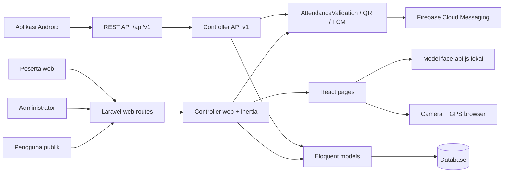
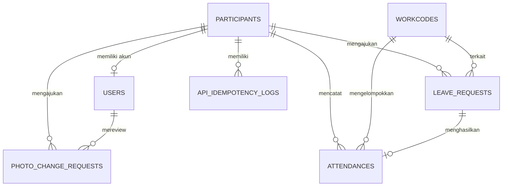

# Dokumentasi dan Analisis Proyek Presensi SMABA

> Dokumen ini merupakan peta teknis menyeluruh untuk repository `acara-smaba` berdasarkan kondisi source code pada 13 Oktober 2026. Dokumen mencakup source aplikasi, konfigurasi, database, antarmuka, API, pengujian, dan deployment. Isi dependency pihak ketiga di `vendor/` dan `node_modules/`, file runtime di `storage/`, serta bundle hasil build yang sudah diminifikasi tidak diaudit baris per baris.

## 1. Ringkasan Eksekutif

Presensi SMABA adalah sistem presensi untuk SMA Negeri 1 Babat. Aplikasi menyediakan:

- panel web administrator untuk mengelola peserta, workcode/sesi presensi, scanner QR, verifikasi wajah, izin, laporan, dan pengaturan;
- portal peserta untuk dashboard, pendaftaran wajah, riwayat izin, dan pengajuan izin;
- presensi mandiri publik melalui Master QR;
- REST API versi 1 untuk aplikasi Android;
- presensi berbasis QR pribadi, face recognition, lokasi/geofence, waktu, dan penguncian perangkat;
- impor peserta dari Excel/CSV dan ekspor laporan;
- notifikasi perubahan workcode melalui Firebase Cloud Messaging (FCM);
- scheduler untuk aktivasi workcode dan perhitungan peserta alpha.

Arsitektur utamanya adalah monolith Laravel dengan frontend React yang dirender melalui Inertia. Database menjadi sumber data bersama untuk web dan mobile API.

## 2. Teknologi

| Lapisan | Teknologi |
|---|---|
| Backend | PHP 8.2+, Laravel 12 |
| Web bridge | Inertia Laravel 2, Ziggy |
| Frontend | React 18, Inertia React 2 |
| Styling/build | Tailwind CSS 3, Vite 7, PostCSS |
| Autentikasi web | Session Laravel/Breeze |
| Autentikasi API | Laravel Sanctum bearer token |
| Pengenalan wajah | `face-api.js` dan model lokal di `public/models/` |
| Pemindaian QR | `html5-qrcode`, `simple-qrcode` |
| Peta/geofence | Google Maps JavaScript API, rumus Haversine di backend |
| Spreadsheet | PhpSpreadsheet |
| Push notification | Firebase Admin SDK/Kreait, FCM topic |
| Testing | PHPUnit 11, Laravel feature tests |
| Database | SQLite sebagai default; konfigurasi MySQL, MariaDB, PostgreSQL, dan SQL Server tersedia |

## 3. Gambaran Arsitektur



Prinsip desain yang sudah terlihat:

- aturan GPS, waktu, perangkat, dan duplikasi sebagian dipusatkan di `AttendanceValidationService`;
- web menggunakan session, CSRF, middleware role, dan Inertia;
- API mobile menggunakan Sanctum, rate limiter, JSON response, dan idempotency log;
- file foto wajah dan bukti izin saat ini disimpan pada disk `public`;
- perubahan workcode disiarkan secara best-effort melalui topic FCM `workcode-updates`.

## 4. Struktur Folder dan File Root

| Path | Fungsi |
|---|---|
| `app/` | Domain aplikasi: model, controller, middleware, service, provider, dan command Artisan. |
| `bootstrap/` | Bootstrap Laravel, registrasi middleware, routing, exception handling, dan provider. |
| `config/` | Konfigurasi aplikasi, database, auth, session, queue, cache, storage, mail, Sanctum, dan Firebase. |
| `database/` | Migration, seeder, dan factory. |
| `deploy/` | Skrip setup dan deployment shared hosting/Hostinger melalui SSH. |
| `public/` | Entry point web, aset publik, bundle build, gambar, dan model AI wajah. |
| `resources/` | Source React, CSS, layout, komponen, halaman, dan root Blade. |
| `routes/` | Route web, auth, API v1, console, dan scheduler. |
| `scripts/` | Utility audit sebelum migration dan pembuat peserta uji. |
| `storage/` | File aplikasi/runtime, upload publik, log, cache, serta lokasi default kredensial Firebase. |
| `tests/` | Unit test dan feature test untuk web serta API. |
| `vendor/` | Dependency Composer; generated dan tidak boleh diedit manual. |
| `node_modules/` | Dependency npm; generated dan tidak boleh diedit manual. |
| `public/build/` | Bundle produksi Vite; saat ini sengaja dapat di-commit. |
| `scratch/` | Eksperimen/diagnostik lokal; diabaikan Git dan bukan bagian alur produksi. |
| `README.md` | Gambaran project, instalasi, dan operasi harian. |
| `docs/` | Seluruh dokumentasi teknis; indeks di `docs/README.md`. |
| `docs/architecture/PROJECT_DOCUMENTATION.md` | Dokumen ini (peta arsitektur). |
| `docs/api/API_CONTRACT.md` | Kontrak detail endpoint web scanner dan API Android. |
| `docs/audits/audit_report.md` | Audit fondasi data/API terdahulu. |
| `docs/implementation/` | Rencana perbaikan Fase 0–6. |
| `docs/ux/walkthrough.md` | Catatan perbaikan UX mobile. |
| `composer.json` | Dependency PHP dan script `setup`, `dev`, serta `test`. |
| `package.json` | Dependency JavaScript dan script Vite. |
| `vite.config.js`, `tailwind.config.js`, `postcss.config.js` | Toolchain frontend. |

Catatan kebersihan repository:

- file backup (`*.bak`) dan skrip diagnostik (`scratch_*.php`) sudah dikeluarkan dari repository dan diabaikan Git (14 Oktober 2026);
- `start_server.bat` kosong dan diabaikan Git;
- `.env` dan `.env.production` ada di working directory tetapi sudah masuk `.gitignore`; nilainya tidak dicantumkan dalam dokumen ini.

## 5. Modul Backend (`app/`)

### 5.1 Model domain

| Model | Tanggung jawab dan relasi penting |
|---|---|
| `User` | Akun login web/API, role `admin` atau `participant`, opsional terhubung ke satu `Participant`, menyimpan token FCM, memakai Sanctum. |
| `Participant` | Identitas orang yang dipresensi, QR token UUID, status kepegawaian, descriptor/foto/status wajah, memiliki banyak attendance dan photo change request. |
| `Workcode` | Sesi presensi aktif: kegiatan sekali atau harian; jadwal, tanggal, lokasi, radius, dan relasi attendance. |
| `Attendance` | Rekaman peserta pada workcode dan tanggal tertentu, waktu datang/pulang, status, perangkat, IP, dan opsional leave request. |
| `LeaveRequest` | Pengajuan izin, rentang tanggal, jenis/tipe izin, keterangan, dokumen, serta status persetujuan. |
| `PhotoChangeRequest` | Kandidat foto/descriptor baru dengan status review, reviewer, waktu review, dan alasan penolakan. |
| `ApiIdempotencyLog` | Menyimpan UUID idempotency, hash request, HTTP status, dan payload response untuk replay aman. |
| `Setting` | Penyimpanan key-value, saat ini dipakai untuk nama dan NIP kepala sekolah. |

### 5.2 Controller web

| Controller | Fungsi utama |
|---|---|
| `AttendanceController` | Scanner QR admin, pencatatan datang/pulang, laporan, rekap individu/harian, CRUD manual, ekspor, dan QR tanda tangan. |
| `ParticipantController` | CRUD peserta, sinkronisasi akun peserta, pencarian/lookup, QR peserta, impor preview/konfirmasi, serta template Excel/CSV. |
| `WorkcodeController` | CRUD, aktivasi/nonaktivasi satu workcode, dan broadcast FCM. |
| `FaceRecognitionController` | Registrasi/approval/penghapusan wajah dan endpoint pencocokan wajah. |
| `SelfCheckInController` | Master QR, rotasi token, formulir publik, dan submit presensi mandiri. |
| `LeaveRequestController` | Pengajuan dan riwayat izin peserta. |
| `AdminLeaveController` | Daftar, approval, rejection, serta pembuatan attendance dari izin yang disetujui. |
| `PhotoChangeRequestController` | Approval/rejection perubahan foto melalui web admin. |
| `SettingController` | Pengaturan identitas kepala sekolah. |
| `VerificationController` | Verifikasi publik tanda tangan laporan per workcode. |
| `HolidayController` | API kalender hari libur. |
| `ProfileController` | Profil akun, password, dan penghapusan akun. |
| `Auth/*` | Login, logout, registrasi, reset password, konfirmasi password, dan verifikasi email. |

### 5.3 Controller API v1

- `AuthController`: login dengan username/email dan pembuatan token Sanctum; logout mencabut token aktif.
- `ProfileController`: profil aman pengguna saat ini.
- `WorkcodeController`: workcode aktif untuk mobile.
- `AttendanceController`: presensi datang/pulang mobile dengan wajah, GPS, installation ID, dan idempotency.
- `AttendanceHistoryController`: riwayat paginated.
- `AttendanceDailyHistoryController`: rekap presensi per hari/bulan.
- `LeaveRequestController`: daftar dan submit izin, termasuk dokumen dan idempotency.
- `PhotoController`: foto aktif, permintaan ganti foto, serta review admin.
- `FcmTokenController`: registrasi/unregistrasi token dan subscription topic.

### 5.4 Service

`AttendanceValidationService` menangani:

- memastikan workcode aktif;
- membatasi self check-in untuk kategori tertentu;
- validasi rentang waktu datang/pulang, termasuk jadwal lintas tengah malam;
- pembuatan device hash;
- aturan satu perangkat untuk satu presensi workcode per hari;
- validasi akurasi GPS, indikasi mock location, selisih waktu perangkat maksimal dua menit, dan radius Haversine;
- pemeriksaan presensi yang sudah ada.

`QrCodeService` menghasilkan SVG/PNG QR biasa, QR dengan logo, serta QR berlabel identitas peserta.

`FcmService` mengirim event `created`, `updated`, `activated`, `deactivated`, dan `deleted` ke topic `workcode-updates`. Kegagalan FCM dicatat ke log tetapi tidak menggagalkan transaksi utama.

### 5.5 Middleware dan provider

- `AdminMiddleware` membatasi route administrator dan mengembalikan JSON 403 untuk request JSON.
- `RoleMiddleware` membatasi route berdasarkan role, dengan admin dapat melewati pembatasan.
- `HandleInertiaRequests` membagikan user terautentikasi dan workcode aktif ke seluruh halaman React.
- `AppServiceProvider` memaksa HTTPS pada production/URL HTTPS, mengatur Vite prefetch, rate limit API 60 request/menit, dan login API 5 request/menit.
- `bootstrap/app.php` memaksa error `/api/v1/*` menjadi JSON dan mengubah respons CSRF 419 web menjadi pesan sesi yang lebih ramah.

### 5.6 Command dan scheduler

| Command | Jadwal/fungsi |
|---|---|
| `attendance:calculate-alpha` | Setiap 5 menit; menghitung status alpha setelah sesi selesai. |
| `workcode:auto-activate` | Setiap menit; mengaktifkan dan menonaktifkan workcode kegiatan sesuai tanggal/jam aktif serta mengirim FCM. |
| `user:make-admin {username}` | Membuat akun admin atau menaikkan akun yang ada; password diminta interaktif. |
| `face:update-descriptor --id=` | Utility pemeliharaan descriptor wajah peserta. |
| `fcm:test [--token=]` | Pengujian push ke topic atau token tertentu. |

Production perlu menjalankan `php artisan schedule:run` setiap menit melalui cron. Untuk development dapat memakai `php artisan schedule:work`.

## 6. Frontend (`resources/`)

Entry React ada di `resources/js/app.jsx`. Semua halaman di-resolve secara dinamis melalui `import.meta.glob`, dibungkus `ToastProvider` dan `ConfirmProvider`, serta memakai progress bar Inertia. AOS diinisialisasi secara global untuk animasi.

Kelompok halaman:

- `Pages/Welcome.jsx`: landing page dan statistik publik;
- `Pages/Dashboard.jsx`: dashboard admin;
- `Pages/Admin/`: Master QR dan pengaturan;
- `Pages/Participants/`: pengelolaan peserta, impor, dan review wajah/foto;
- `Pages/Workcodes/`: pengelolaan sesi, waktu, lokasi, dan status aktif;
- `Pages/Scanner/`: scanner QR admin;
- `Pages/Report/`: laporan dan rekap presensi;
- `Pages/LeaveApprovals/`: pusat verifikasi izin;
- `Pages/Participant/`: dashboard peserta, registrasi wajah, dan riwayat izin;
- `Pages/SelfCheckIn/`: alur publik pemilihan peserta dan face check-in;
- `Pages/Auth/` dan `Pages/Profile/`: autentikasi serta profil;
- `Pages/VerifySignature.jsx`: validasi publik laporan.

Komponen penting:

- scanner/biometrik: `AdminFaceScanner`, `FaceScannerModal`, `FaceRegistrationModal`, `SelfFaceRegistrationModal`;
- workflow: `ImportModal`, `LeaveRequestModal`, `ApproveFaceModal`, `ApprovePhotoChangeRequestModal`, `AttendanceCalendarModal`;
- UI umum: modal, dialog konfirmasi, toast, dropdown, button, input, checkbox, dan navigation link;
- `Utils/liveness.js`: utility pemeriksaan liveness wajah;
- `Layouts/AuthenticatedLayout.jsx` dan `GuestLayout.jsx`: shell halaman berdasarkan status login.

Catatan kamera: browser hanya memberikan akses kamera secara andal pada secure context, yaitu `localhost` atau HTTPS.

## 7. Alur Bisnis Utama

### 7.1 Workcode

Kategori tersimpan:

| Nilai | Arti |
|---|---|
| `workcode` | Kegiatan satu kali dengan tanggal serta jam mulai/selesai untuk aktivasi otomatis. |
| `harian` | Presensi berulang dengan hari aktif, jadwal per hari, datang, dan pulang. |

Hanya satu workcode dimaksudkan aktif pada satu waktu. Kegiatan otomatis aktif tepat pada awal rentang waktu dan tidak lagi dapat dipakai pada jam selesai. Scheduler menyinkronkan flag database setiap menit, sedangkan backend tetap memeriksa rentang waktu secara langsung agar presensi di luar jadwal selalu ditolak.

### 7.2 QR scanner admin

1. Admin membuka scanner dan aplikasi membaca QR token pribadi peserta.
2. Backend memuat workcode aktif dan peserta.
3. Jika workcode memiliki koordinat, lokasi diperiksa bila scanner mengirim GPS.
4. Untuk `harian`, scan pertama mencatat datang dan scan berikutnya mencatat pulang.
5. Untuk kategori lain, rekaman yang sudah ada dikembalikan sebagai `already`.
6. Attendance menyimpan tanggal, waktu, status `hadir`, device hash, dan IP.

### 7.3 Self check-in publik

1. Admin menampilkan Master QR yang berisi token workcode.
2. Peserta membuka `/self-checkin/{token}` tanpa login.
3. Peserta dicari/dipilih dan mengirim data perangkat serta GPS.
4. Service memvalidasi workcode, perangkat, akurasi/waktu GPS, radius, dan duplikasi.
5. Presensi dibuat jika seluruh aturan terpenuhi.

Workcode harian sengaja tidak diizinkan pada alur self check-in tertentu dan diarahkan melalui scanner QR pribadi oleh petugas/admin.

### 7.4 Face recognition

- Browser memuat model face-api.js dari `public/models/`.
- Descriptor adalah vector 128 dimensi; web mendukung single vector maupun kumpulan vector.
- Hanya wajah berstatus `approved` yang dipakai untuk pencocokan publik.
- Web menggunakan ambang Euclidean sekitar `0.58`.
- API mobile melakukan normalisasi descriptor database dan memakai ambang `0.85`.
- Registrasi admin langsung approved; registrasi mandiri peserta menjadi pending.
- Perubahan foto melalui API menggunakan candidate record agar foto aktif tidak langsung terganti sebelum review.

Perbedaan threshold dan implementasi web/mobile harus diperlakukan sebagai area sensitif saat mengganti model AI atau format descriptor.

### 7.5 Izin

Jenis alur izin mendukung:

- `izin_penuh`;
- `tidak_absen_datang`;
- `tidak_absen_pulang`.

Kategori alasan meliputi sakit, force majeure, tidak masuk dengan keterangan, perjalanan dinas, cuti, serta diklat/pelatihan. Pengajuan dapat memiliki rentang beberapa hari dan dokumen bukti. Sistem menolak pengajuan tumpang tindih untuk peserta, workcode, dan tanggal yang sama. Approval admin dapat membuat/menghubungkan attendance sesuai tipe izin.

### 7.6 Laporan

- workcode harian menghasilkan rekap per peserta dan per tanggal;
- hari tanpa rekaman dapat diisi sebagai alpha/libur sesuai logika rekap;
- workcode satu kali menampilkan satu baris status per peserta;
- admin dapat mengubah attendance manual;
- ekspor menyertakan identitas kepala sekolah dari tabel settings;
- QR tanda tangan mengarah ke halaman verifikasi publik workcode.

## 8. Model Data Akhir

### 8.1 Tabel domain

| Tabel | Kolom penting |
|---|---|
| `users` | `name`, email nullable, `username` unik, password, role, `participant_id`, `fcm_token`, verification/session fields. |
| `participants` | nama, `nis_nip` nullable/unik, status, `qr_token` unik, `face_descriptor` JSON, `face_status`, `photo_path`. |
| `workcodes` | nama/deskripsi, kategori, tanggal, jam aktif kegiatan, hari aktif JSON, jadwal per hari JSON, empat batas waktu harian, koordinat, radius, `is_active`. |
| `attendances` | workcode, participant, tanggal, waktu hadir/pulang, status, leave request, device hash, IP. |
| `leave_requests` | participant, workcode, tanggal awal/akhir, tipe, tipe izin, jenis izin, keterangan/alasan, bukti, approval. |
| `photo_change_requests` | participant, candidate photo/descriptor, status, reviewer, review time, rejection reason. |
| `api_idempotency_logs` | participant, key UUID, request hash, response code/payload. |
| `settings` | key unik dan value. |

Tabel infrastruktur Laravel juga tersedia: `sessions`, `password_reset_tokens`, `personal_access_tokens`, `cache`, `cache_locks`, `jobs`, `job_batches`, dan `failed_jobs`.

### 8.2 Constraint penting

- satu attendance per kombinasi `(workcode_id, participant_id, tanggal)` melalui unique constraint `unique_attendance`;
- satu idempotency key per participant;
- QR token participant unik;
- username user unik;
- foreign key participant/workcode umumnya cascade, sedangkan referensi reviewer/user memakai null-on-delete;
- `nis_nip` boleh null untuk status non-permanen seperti GTT/PTT.

### 8.3 Relasi ringkas



## 9. Route dan Hak Akses

### 9.1 Route publik

- `GET /`: landing page, statistik, dan aktivitas terbaru dengan nama disamarkan;
- lookup/search peserta dan unduh QR peserta;
- `GET|POST /self-checkin/{token}`;
- `GET /api/holidays`;
- `POST /api/face/match`;
- `GET /verify-signature/{workcode}`;
- fallback `GET /storage/{path}` untuk hosting tanpa symlink;
- route login dan reset password dari `routes/auth.php` (registrasi publik sudah ditutup).

### 9.2 Route admin

Dilindungi `auth`, `verified`, dan `admin`:

- `/dashboard`, `/workcodes`, `/participants`, `/scanner`, `/report`;
- approval izin dan foto/wajah;
- Master QR dan regenerasi token;
- presensi manual dan ekspor;
- pengaturan kepala sekolah.

### 9.3 Route peserta

Dilindungi `auth`, `verified`, dan `role:participant`:

- `/participant/dashboard`;
- `/participant/face-registration`;
- registrasi wajah sendiri;
- submit dan riwayat izin.

### 9.4 API mobile `/api/v1`

| Method/path | Akses | Fungsi |
|---|---|---|
| `POST /auth/login` | Publik, rate limited | Login dan token Sanctum. |
| `POST /auth/logout` | Token | Mencabut token aktif. |
| `GET /me` | Token | Profil pengguna. |
| `GET /me/photo` | Token peserta | Foto wajah aktif. |
| `POST /me/photo-change-requests` | Token peserta + idempotency | Kandidat foto baru. |
| `GET/PATCH /admin/photo-change-requests...` | Token admin | Daftar/approve/reject candidate. |
| `GET /workcodes/active` | Token peserta | Workcode aktif. |
| `GET /attendance-history` | Token peserta | Riwayat paginated. |
| `GET /attendance-history/daily` | Token peserta | Rekap harian. |
| `POST /attendance` | Token peserta + idempotency | Presensi GPS+wajah. |
| `GET/POST /leave-requests` | Token + idempotency untuk POST | Riwayat dan pengajuan izin. |
| `POST /attendances/leave` | Token + idempotency | Alias submit izin kompatibilitas. |
| `POST /fcm/register` | Token | Simpan token dan subscribe topic. |
| `DELETE /fcm/unregister` | Token | Hapus token dan unsubscribe. |

Request mutasi mobile memakai header `Idempotency-Key` berbentuk UUID. Replay dengan payload sama mengembalikan respons tersimpan; key sama dengan payload berbeda menghasilkan HTTP 409. Detail payload dan response terdapat di `API_CONTRACT.md`.

## 10. Konfigurasi dan Instalasi Lokal

Kebutuhan minimum:

- PHP 8.2 atau lebih baru beserta extension Laravel/PHPUnit (`mbstring`, `openssl`, `pdo`, `xml`, `xmlwriter`, `dom`, `fileinfo`, `curl`, dan `zip`; `gd` dibutuhkan untuk pengolahan gambar tertentu);
- Composer;
- Node.js 20+ dan npm;
- SQLite atau server database lain.

Instalasi cepat:

```bash
composer setup
php artisan db:seed
php artisan storage:link
composer dev
```

Instalasi manual:

```bash
composer install
cp .env.example .env
php artisan key:generate
php artisan migrate
npm install
npm run build
```

Variabel lingkungan yang paling penting:

- aplikasi: `APP_NAME`, `APP_ENV`, `APP_KEY`, `APP_DEBUG`, `APP_URL`, `APP_TIMEZONE`;
- database: `DB_CONNECTION`, `DB_HOST`, `DB_PORT`, `DB_DATABASE`, `DB_USERNAME`, `DB_PASSWORD`;
- session/cache/queue: `SESSION_DRIVER`, `CACHE_STORE`, `QUEUE_CONNECTION`;
- mail: kelompok `MAIL_*`;
- Sanctum: `SANCTUM_STATEFUL_DOMAINS`, `SANCTUM_TOKEN_PREFIX`;
- Firebase: `FIREBASE_PROJECT`, `FIREBASE_CREDENTIALS` atau `GOOGLE_APPLICATION_CREDENTIALS`, serta opsi database/storage/logging Firebase.

Kredensial service account Firebase secara default diarahkan ke file privat seperti `storage/app/firebase-credentials.json` dan file tersebut sudah diabaikan Git.

Seeder membuat akun administrator development dan data peserta contoh. Password bawaan seeder hanya untuk lokal dan wajib diganti sebelum instance dapat diakses pihak lain.

## 11. Testing

Test suite mencakup:

- autentikasi, registrasi, reset/update/konfirmasi password, dan profil;
- CRUD/skenario workcode untuk kategori kegiatan dan harian;
- presensi manual dan QR admin;
- self check-in, GPS palsu, akurasi rendah, clock skew, radius, device lock, dan duplikasi;
- approval izin penuh/sebagian dan izin multi-hari;
- status pegawai permanen/non-permanen serta impor;
- pengajuan dan review perubahan foto;
- autentikasi, profile, workcode, attendance, history, leave, FCM, idempotency, role, dan format error JSON API.

Perintah:

```bash
composer test
# atau
php artisan test
```

Status verifikasi pada 13 Oktober 2026: test suite belum dapat dieksekusi sampai selesai pada environment analisis. Binary PHP ditemukan di drive `F:`, tetapi `php.ini` menunjuk extension directory di `C:/laragon/...`, sehingga extension termasuk `mbstring`, `pdo_sqlite`, `xml`, `curl`, dan lainnya gagal dimuat. PHPUnit berhenti karena `mbstring` tidak tersedia. Ini adalah masalah konfigurasi runtime lokal, bukan hasil test gagal pada assertion aplikasi.

Perbaikan environment yang disarankan:

1. pastikan CLI memakai `php.ini` milik instalasi PHP di drive `F:`;
2. sesuaikan `extension_dir` ke folder `ext` yang benar;
3. jalankan `php -m` dan pastikan extension minimum aktif;
4. ulangi `php artisan test`.

## 12. Deployment

Alur aktif yang didokumentasikan oleh `deploy/deploy.ps1`:

1. baca koneksi dari `deploy/.env.deploy`;
2. build aset dengan `npm run build`;
3. pastikan perubahan Git sudah di-stage/commit dan push branch `main`;
4. konek ke server dengan SSH key;
5. server menjalankan `git pull`, `composer install --no-dev --optimize-autoloader --no-scripts` lalu `php artisan package:discover` (PHP CLI Hostinger menonaktifkan `proc_open`), `php artisan migrate --force`, serta cache config dan view. `route:cache` sengaja tidak dipakai karena cache route yang dihasilkan di server membuat `GET /` gagal 405;
6. isi `public/` disalin ke folder web publik, lalu path di `index.php` diarahkan ke `../../presensi-app/` dan diverifikasi sebelum aplikasi diaktifkan kembali.

File pendukung:

- `server-setup.sh`: bootstrap instalasi awal;
- `deploy-server.sh`: langkah deploy yang dijalankan di server;
- `setup_public_html.sh`: menyalin public assets dan menyesuaikan path front controller/symlink;
- `init_staging.sh` dan `staging_index.php`: dukungan staging;
- `pre_migration_audit.php`: pemeriksaan data sebelum perubahan schema tertentu.

Production harus memakai `APP_ENV=production`, `APP_DEBUG=false`, HTTPS, database backup sebelum migration, queue worker bila queue dipakai, scheduler cron, permission minimal untuk `storage/` dan `bootstrap/cache/`, serta kredensial di environment/file privat.

## 13. Temuan Risiko dan Prioritas

### Kritis

1. ~~**Registrasi publik dapat menghasilkan akun admin.**~~ **Selesai 14 Oktober 2026.** Route `/register` dan `RegisteredUserController` dihapus, `role` dikeluarkan dari `$fillable`, default kolom `role` menjadi `participant`, dan admin baru dibuat lewat `php artisan user:make-admin`. Audit produksi saat perbaikan: hanya 1 admin, semuanya memiliki username, sehingga tidak ada tanda akun hasil registrasi publik.

2. **Kredensial SSH plaintext pernah di-commit di `deploy/test.ps1`.** File sudah dihapus (14 Oktober 2026) dan deploy memakai SSH key + `deploy/.env.deploy`. Password tidak dirotasi atas keputusan pemilik karena akun Hostinger dipakai bersama, sehingga password lama **masih terbaca di history repo publik**. Mitigasi tersisa: bersihkan history (Fase 0.4) atau jadikan repo privat.

3. **Admin produksi dan staging memakai password bawaan dari seeder** yang tertulis di history repo publik. Password bawaan sudah dihapus dari `DatabaseSeeder` dan `init_staging.sh`, tetapi akun yang sudah ada harus diganti passwordnya dengan `php artisan user:make-admin admin`.

### Tinggi

3. ~~**Data biometrik lengkap dicatat ke log oleh API attendance.**~~ **Selesai (Fase 1, Okt 2026).** Log descriptor/jarak dihapus, penyaring log `App\Logging\RedactSensitiveData` aktif, dan log lama dibersihkan.

4. ~~**Dokumen izin disimpan pada disk publik.**~~ **Selesai (Fase 1, Okt 2026).** Foto wajah, foto presensi, tanda tangan, dan dokumen izin kini di disk `private` dan hanya disajikan lewat URL bertanda tangan (`App\Support\PrivateFile`); fallback `/storage/{path}` di-whitelist. Lihat `docs/security.md`.

5. **Endpoint face match bersifat publik dan melakukan pencarian 1:N ke seluruh peserta approved.** Endpoint juga dapat membuat attendance. Tambahkan token sesi/nonce Master QR berumur pendek, rate limit khusus, validasi liveness yang diwajibkan, dan pertimbangkan pencocokan 1:1 setelah identitas peserta dipilih.

6. **Route unduh QR dan lookup peserta bersifat publik.** Evaluasi apakah QR token dan NIS/NIP dapat dienumerasi atau bocor. Minimal tambahkan signed URL/authorization dan batasi field respons.

### Menengah

7. **Logika presensi terduplikasi.** Web QR, self check-in, face match, dan API mobile masih memiliki cabang validasi/pencatatan sendiri. Hal ini sudah menimbulkan perbedaan threshold wajah, toleransi clock skew, perilaku GPS, dan aturan waktu. Satukan orchestration dalam satu domain service.

8. **Aktivasi tunggal workcode tidak dijamin database.** `update all false` lalu `update true` tidak dibungkus transaksi/lock pada semua jalur. Dua request bersamaan dapat menghasilkan kondisi tidak konsisten.

9. **Idempotency log tidak memiliki kebijakan kedaluwarsa.** Tabel akan terus bertambah. Tambahkan pruning terjadwal dan indeks waktu bila volume API meningkat.

10. **`trustProxies('*')` terlalu luas jika aplikasi dapat diakses langsung.** Batasi ke proxy/load balancer tepercaya agar IP dan scheme tidak mudah dipalsukan melalui forwarded headers.

11. **Mekanisme foto wajah lama dan photo change request berjalan paralel.** Registrasi mandiri lama langsung mengganti `Participant.photo_path` sebelum approval, sedangkan flow baru menggunakan candidate record. Konsolidasikan agar foto aktif selalu terlindungi sampai approval.

12. **Status/istilah kategori tidak sepenuhnya konsisten.** Database/controller menggunakan `workcode`, sedangkan beberapa service/komentar menyebut `kegiatan`. Gunakan enum/value object agar perbedaan string tidak membuat aturan terlewati.

### Rendah dan maintainability

13. Controller besar seperti `ParticipantController`, `AttendanceController`, dan `FaceRecognitionController` menggabungkan validasi, query, file I/O, domain rule, dan formatting response. Pecah menjadi Form Request, action/service, policy, dan resource.

14. Ada artefak backup/scratch dan dokumentasi audit lama di root. Pindahkan dokumentasi ke `docs/`, hapus artefak yang tidak dipakai setelah diverifikasi, dan buat aturan kontribusi.

15. Bundle `public/build` di-commit untuk kebutuhan server tanpa Node. Proses ini valid untuk shared hosting, tetapi harus dipastikan selalu dibangun dari source yang sama dan diverifikasi di CI agar tidak stale.

## 14. Rekomendasi Roadmap

Urutan yang disarankan:

1. tutup celah registrasi admin dan rotasi seluruh kredensial yang terekspos;
2. hentikan logging biometrik dan privatkan dokumen izin/foto sensitif;
3. lindungi endpoint face match, lookup, dan unduh QR;
4. perbaiki PHP CLI lalu jalankan seluruh test sebagai baseline;
5. satukan seluruh pencatatan presensi dalam application/domain service transaksional;
6. gunakan Policy/Form Request/API Resource secara konsisten;
7. tambah cleanup idempotency log, backup otomatis, monitoring scheduler/queue, dan alerting;
8. tambahkan CI untuk test PHP, lint/format, build frontend, dan pemeriksaan secret;
9. konsolidasikan dokumentasi lama di bawah `docs/` dan pertahankan file ini sebagai indeks arsitektur.

## 15. Panduan Pengembangan Singkat

Saat menambah fitur presensi:

- jangan membuat attendance tanpa mengisi `tanggal`;
- hormati unique constraint workcode/participant/tanggal;
- gunakan transaksi untuk perubahan attendance + leave/idempotency terkait;
- gunakan waktu server sebagai sumber kebenaran;
- jangan mengembalikan jarak aktual, descriptor, token, atau data peserta lain pada error publik;
- tambahkan test untuk web dan API bila rule dipakai keduanya;
- jangan log payload biometrik, password, token, dokumen, atau koordinat presisi tanpa kebutuhan yang sah;
- pastikan upload divalidasi berdasarkan MIME, ukuran, dan disimpan pada visibility yang tepat;
- broadcast FCM tidak boleh menentukan keberhasilan transaksi inti.

Saat menambah migration:

1. audit data existing;
2. backup database production;
3. isi/backfill kolom nullable terlebih dahulu;
4. baru terapkan `NOT NULL` atau unique constraint;
5. uji migration pada salinan data production;
6. pastikan `down()` aman dan realistis.

## 16. Dokumen Terkait

- [README.md](../../README.md) — gambaran project, quick start, dan operasi harian;
- [API_CONTRACT.md](../api/API_CONTRACT.md) — kontrak request/response API;
- [audit_report.md](../audits/audit_report.md) — audit model data/API;
- [implementation/](../implementation/README.md) — rencana perbaikan Fase 0–6;
- [walkthrough.md](../ux/walkthrough.md) — perubahan UX mobile-first;
- `business_logic_audit.md` dan `face_recognition_analysis.md` — audit lama, hanya disimpan lokal (diabaikan Git).

Dokumen ini sebaiknya diperbarui ketika schema, route, role, alur presensi, atau deployment berubah.
